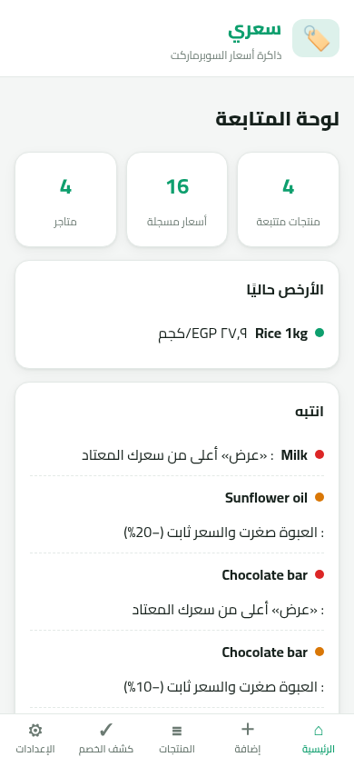
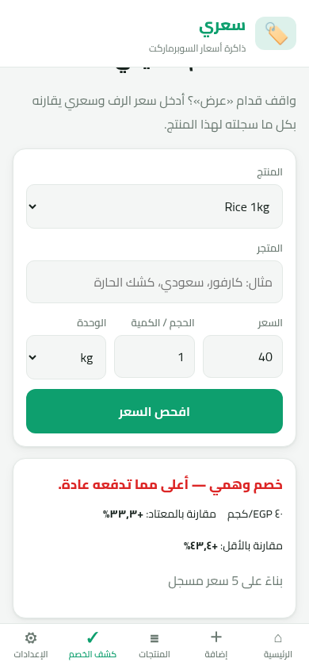
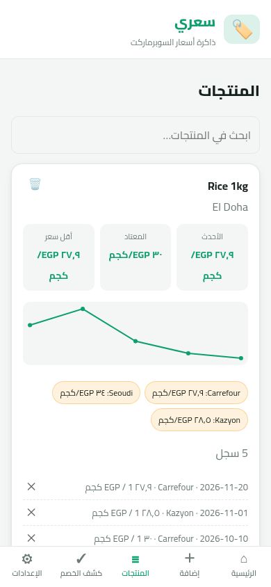

# Se3ry — سعري


**Supermarket price memory.** Record what you actually pay, and Se3ry remembers — so the next "OFFER!!" sticker has to prove itself against your own history, not the store's marketing.

**Live app:** https://yousefkhames.github.io/se3ry/

Se3ry is a free, offline-first, static web app. No account, no server, no tracking. Your data lives in your browser's localStorage and never leaves your device unless you export it yourself.

Fully bilingual: **العربية** (RTL) and **English**, mobile-first.

---

## What it does

- **Price memory** — log every purchase: product, store, date, price, pack size, unit. Build your own price history instead of trusting memory.
- **Unit price everywhere** — 800 ml vs 1 L? 250 g vs 1 kg? Se3ry normalizes everything to price per kg / liter / piece so packs are honestly comparable.
- **Real-discount detector** — standing in front of a "deal"? Enter the shelf price. Se3ry compares it against your recorded history and rules: real deal (at/below your best ever), genuinely good, fair, or **fake discount** (above your typical price).
- **Shrinkflation alerts** — detects when the pack shrank while the price held: 40 g → 36 g → 32 g at the same 10 EGP is a price rise in disguise.
- **Store comparison** — per product, which store was cheapest, with best/latest/typical unit prices and a price-history chart.
- **Dashboard** — products at their cheapest-ever price right now, plus warnings (fake "sale" flags, shrinking packs).
- **Export / import** — full JSON backup, CSV export of all prices, branding export (see below).

## White-label ready

One codebase, any shop. The settings screen rebrands the whole app — Arabic and English names, taglines, logo, primary/accent colors, currency, default language, theme — and exports it as a small `se3ry-branding.json`. A retailer gets their own branded price-memory app by importing one file. Deal threshold (how far below typical counts as a good price) is configurable too.

## Screenshots

| Dashboard | Deal check | Products |
|---|---|---|
|  |  |  |

## Tech

- Vanilla HTML / CSS / JS. Zero dependencies, zero build step.
- Core logic (`js/core.js`) is a pure module shared by the browser and the test suite.
- Charts are hand-rolled SVG. Cairo is bundled in `fonts/` (no third-party requests), with system fallbacks. Arabic prices show as "٢٧٫٩ ج.م/كجم".
- Tests: Node's built-in test runner (`node --test`), 21 unit tests covering unit conversion, statistics, discount verdicts, shrinkflation detection, CSV export and settings.
- Hosting: GitHub Pages, straight from `main`.

## Run locally

Open `index.html` in any browser, or serve the folder (`python3 -m http.server`). Tests need Node 18+:

```bash
npm test
```

## Honest limits

- **Your data, your device.** localStorage means no sync between phone and laptop, and clearing browser data wipes the history. Export backups regularly (Settings → Export).
- The discount detector needs **at least 3 recorded prices** for a product before it rules on a deal; below that it says "not enough history" instead of guessing.
- It compares against *your* history. If you only ever shopped during inflated prices, "typical" reflects that.
- No barcode scanning, no crowdsourced prices, no flyers import — everything is typed in by hand.
- A price of 0 (free item) is rejected as invalid input.

## License

[MIT](LICENSE) — do what you like, keep the notice.
